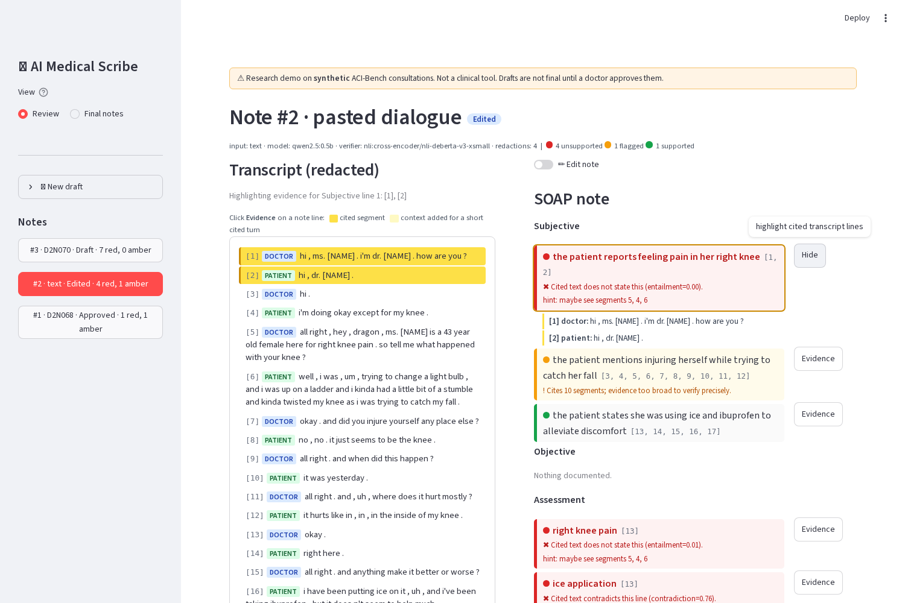
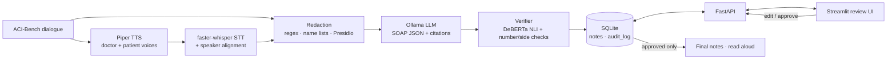

<div align="center">

# 🩺 AI Medical Scribe

**Turn a doctor–patient conversation into an evidence-linked SOAP note,
flag every line the transcript doesn't support, and keep nothing final until a doctor approves it.**

100% local · 100% free · open-source models only


-blueviolet)

</div>

> [!WARNING]
> **Research demo on synthetic data (ACI-Bench). Not a clinical tool and not a medical device.**
> Never use it with real patient data.

<p align="center">
  
  <br><em>The review screen. Clicking a note line highlights the transcript segments it cites. Red lines say why they failed and where the support might be.</em>
</p>

---

## Why this project?

AI scribes save doctors hours of typing, but a language model can **invent clinical facts** that sound right.
This project is built around one rule: **every line of the note must point to the exact words in the conversation that support it**.
Any line that can't be traced back gets flagged in red, and a doctor has to approve the note before it counts as final.

## ✨ Features

| | |
|---|---|
| 🔗 **Evidence-linked notes** | Every SOAP line cites the transcript segment IDs it came from. Click a line to see them highlighted |
| 🚩 **Hallucination flags** | A local NLI verifier (DeBERTa), plus number and left/right checks, marks each line 🟩 supported · 🟧 weak · 🟥 unsupported, with the reason |
| 🕵️ **Redaction first** | Names, phones, emails and IDs become `[NAME]`, `[PHONE]`, `[EMAIL]`, `[ID]` **before** anything reaches the LLM, the database or the logs |
| 👩‍⚕️ **Doctor-in-the-loop** | Edit, delete or add lines (each change is re-redacted and re-verified), then approve. Approved notes are locked by SQLite triggers |
| 📜 **Audit trail** | Every create, edit and approve is logged with before/after JSON in an append-only table |
| 🎙️ **Speech in, speech out** | Piper speaks synthetic dialogues in two voices, faster-whisper transcribes them, and the approved note can be read aloud |
| 🧪 **Tested and measured** | 250 tests (unit, API, integration, Playwright E2E), plus evaluations of note quality, WER, redaction and the verifier |

## 🏗️ How it works



1. **Transcribe**: audio (or text) becomes numbered, speaker-labelled segments.
2. **Redact**: PII is replaced before it is stored, logged or sent to the model.
3. **Generate**: Ollama writes the SOAP note as JSON constrained by a schema, at temperature 0.1. The rules are: use only the numbered segments, cite IDs for every item, and set `unsupported=true` instead of guessing. The output is validated with Pydantic, with one retry.
4. **Verify**: each line is checked against the segments it cites, and unsupported lines get a hint about where the support might be.
5. **Review and approve**: the doctor fixes the draft. Only approved notes reach the final view.

## 📊 Results

Measured in a **2 GB RAM, 2-CPU, no-GPU sandbox** with small models (the default `qwen2.5:7b` didn't fit). Full tables are in the [project README](ai-medical-scribe/README.md#results).

**Verifier: does it catch invented lines?** (hand-labelled set of 40 lines: 22 faithful, 18 hallucinated)

| Backend | Hallucinations caught | False alarms |
|---|---|---|
| NLI DeBERTa-v3-base (default) | **89%** | **0%** |
| NLI DeBERTa-v3-xsmall (low RAM) | 83% | 5% |
| LLM judge (qwen2.5:0.5b) | 33% | 0% |

**Pipeline components**

| Check | Result |
|---|---|
| Patient-name redaction (283 mentions in ACI-Bench) | **99.6%** redacted |
| Seeded fake PII (40 per type) | NAME 95% · PHONE / EMAIL / ID 100% |
| Speech-to-text, Whisper `base.en` on CPU (23 min of audio) | **4.8% WER**, 100% of numbers correct, 0.07× real time |
| Audio → verified draft (2 min of audio, 0.5b model) | 85 s |

**Note quality** (20 ACI-Bench validation cases)

| Model | Valid JSON | Invented lines | Reference facts missed | ROUGE-L | BERTScore |
|---|---|---|---|---|---|
| qwen2.5:0.5b | 20/20 | 28% | 89% | 0.249 | 0.319 |
| qwen2.5:1.5b | 20/20 | 28% | 88% | 0.232 | 0.341 |

**The honest takeaway:** small models write notes that are far too short, and about **1 line in 4 has no support in the transcript**.
That is why every line is verified and nothing is final without a doctor. The 7b row hasn't been measured yet; on a machine with 8 GB+ RAM, `make eval-7b` adds it.

## 🚀 Quick start

**Requirements:** Python 3.11, [Ollama](https://ollama.com/download), and about 16 GB of RAM for `qwen2.5:7b` (smaller models work on 4–8 GB).

```bash
git clone https://github.com/Hamad-Ansari/AI-Medical-Scribe.git
cd AI-Medical-Scribe/ai-medical-scribe

pip install uv
uv venv -p 3.11 .venv
source .venv/bin/activate          # Windows: .venv\Scripts\activate
uv pip install torch --index-url https://download.pytorch.org/whl/cpu   # Windows: uv pip install torch
uv pip install -r requirements.txt

python scripts/download_aci_bench.py   # synthetic consultations
python scripts/download_voices.py      # Piper voices (ryan = doctor, amy = patient)
ollama pull qwen2.5:7b                 # or qwen2.5:3b / qwen2.5:0.5b on weaker PCs

python run.py                          # API + review UI → http://localhost:8501
```

**Just want to see the UI?** `python run.py --demo` uses scripted models: no Ollama and no model downloads.

Step-by-step setup for Windows, macOS and Linux, low-RAM settings and troubleshooting are in **[RUN.md](ai-medical-scribe/RUN.md)**.

## 🧪 Tests

| Layer | Command | What it covers |
|---|---|---|
| Unit + API | `python -m pytest` | 239 tests in about 10 s: schema validation, redaction with seeded fake PII, verifier rules, the approval gate, audit triggers, empty or bad audio errors, every endpoint. No models needed |
| Integration | `python -m pytest -m slow` | FastAPI audio upload → Whisper → segments, real NLI, real Piper voices |
| E2E | `python -m pytest -m e2e tests/e2e` | 6 Playwright tests drive the real Streamlit UI: highlight, edit, approve, lock, read aloud, audit |
| AI eval | `make eval` · `make stt-eval` · `make redaction-eval` | note quality, WER (jiwer), PII recall, hallucination catch rate |

## 📁 Project structure

```
ai-medical-scribe/
├── app/            # pipeline: loader, schema, generate, verify, redact, stt, tts, store, FastAPI (main.py)
├── ui/review.py    # Streamlit review screen (talks to the API over HTTP)
├── eval/           # note-quality, WER, redaction and verifier evaluations + results/
├── tests/          # pytest unit/API/integration tests, tests/e2e = Playwright
├── scripts/        # downloads (data, voices), smoke tests, helpers
├── docs/GUIDE.md   # 16-section guide book: how every part works
├── run.py          # one-command launcher (python run.py / --demo)
├── RUN.md          # setup and troubleshooting
└── requirements.txt
```

📖 To learn how everything works, read the **[guide book](ai-medical-scribe/docs/GUIDE.md)**: architecture, prompts, verifier design, testing, evaluation and limitations.

## ⚠️ Limitations

- **Synthetic data only.** ACI-Bench dialogues are scripted and clean, and the two-voice synthetic audio is much easier than a real clinic.
- **Small models in the reported eval.** 0.5b–1.5b models often cite the wrong segments and miss most facts. Use 7b+ for real notes.
- **The verifier checks against the transcript, not the truth.** Speech-recognition errors in drug names (e.g. *lisinopril* came out as "listen apple") and clinically similar substitutions slip through.
- **Automatic metrics are estimates.** Invented and missing facts are judged by an NLI model that can be fooled. No clinician reviewed the notes.
- **Redaction is not perfect.** Some unusual names leak, and one drug name was over-redacted.
- **Approval is not authentication.** A real system needs accounts, roles, e-signatures and access logs.

## 🙏 Data and credits

- **ACI-Bench** © its authors, CC BY 4.0. Yim, W. et al. *ACI-BENCH: a Novel Ambient Clinical Intelligence Dataset for Benchmarking Automatic Visit Note Generation.* Scientific Data 10, 586 (2023).
- Built with [Ollama](https://ollama.com) · [Qwen2.5](https://github.com/QwenLM/Qwen2.5) · [faster-whisper](https://github.com/SYSTRAN/faster-whisper) · [Piper](https://github.com/rhasspy/piper) · [Presidio](https://github.com/microsoft/presidio) · [DeBERTa NLI cross-encoders](https://huggingface.co/cross-encoder) · FastAPI · Streamlit. Each is used under its own open licence.
- SCOWL word list © Kevin Atkinson.

## 👤 Author

**Hamad Ansari** · [GitHub @Hamad-Ansari](https://github.com/Hamad-Ansari)

If this project is useful or interesting to you, a ⭐ helps others find it.
