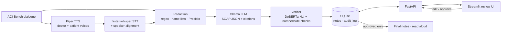

# AI Medical Scribe

**Local, free, open-source pipeline that turns a doctor–patient consultation into an evidence-linked SOAP note,
flags every statement the transcript doesn't support, and keeps nothing final until a doctor approves it.**

> ⚠️ **Research demo on synthetic data (ACI-Bench). Not a clinical tool and not a medical device.**
> Never use it with real patient data.

Python 3.11 · FastAPI · Streamlit · SQLite · Pydantic v2 · Ollama (Qwen2.5) · faster-whisper · Piper · Presidio · DeBERTa NLI · pytest + Playwright

| | |
|---|---|
| ▶️ **Run it** | [RUN.md](RUN.md): `python run.py` (or `python run.py --demo` with no models) |
| 📖 **Guide book** | [docs/GUIDE.md](docs/GUIDE.md): how every part works, testing, evaluation, limitations, interview notes |

---

## What it does

1. **Speech (optional):** Piper speaks a synthetic ACI-Bench dialogue in two voices, and faster-whisper transcribes it into numbered,
   speaker-labelled segments.
2. **Redaction first:** names, phones, emails and IDs become `[NAME]`, `[PHONE]`, `[EMAIL]`, `[ID]` *before* anything reaches the LLM, the database or the logs.
3. **Generation:** a local LLM (Ollama, JSON-schema constrained, temperature 0.1) writes a SOAP note in which **every line cites
   the segment IDs it came from**. Where the transcript doesn't support a line, it must set `unsupported=true` rather than guess.
4. **Verification:** each line is checked against its cited segments (NLI entailment, number and left/right checks):
   🟩 supported · 🟧 weak · 🟥 unsupported, with a reason. Lines with no matching transcript text are highlighted, and
   the verifier suggests where the support might be.
5. **Doctor review:** the transcript sits beside the note; clicking **Evidence** highlights the supporting segments in yellow.
   The doctor edits, deletes or adds lines (re-redacted and re-verified on save), then **approves**.
6. **Approval gate and audit:** approved notes are locked by SQLite triggers, only approved notes reach the final view and read-aloud,
   and every step is logged with before/after JSON.


## Architecture



```
ACI dialogue ─┬──────────── text ───────────────┬─▶ redact ─▶ LLM ─▶ verify ─▶ SQLite (draft)
              └─▶ Piper ─▶ WAV ─▶ Whisper ─▶ align ┘                                  │
     Final notes ◀── approved only ◀── approve ◀── edit (re-redact + re-verify) ◀── review UI
```

| Module | Role |
|---|---|
| `app/loader.py` | ACI-Bench CSV → segments; reference notes → SOAP sections |
| `app/schema.py` | `NoteItem {text, evidence, unsupported}`, `SOAPNote`, the JSON schema for Ollama |
| `app/generate.py` | Ollama `/api/chat`, Pydantic validation, one retry |
| `app/verify.py`, `app/evidence.py` | per-line status, reasons, evidence suggestions, re-verifying edits |
| `app/redact.py` | regex, name lists, context rules, Presidio/spaCy; global log redaction |
| `app/tts.py`, `app/stt.py`, `app/textnorm.py` | Piper voices, faster-whisper, speaker alignment, audio validation |
| `app/store.py` | SQLite notes + append-only audit log, enforced by triggers |
| `app/main.py` | FastAPI: `/process`, `/note/{id}` (GET/PUT), `/note/{id}/approve`, audit, final, audio |
| `ui/review.py` | Streamlit review screen (talks to the API over HTTP) |
| `run.py` | one-command launcher with clear startup checks |
| `eval/` | note quality, STT WER, redaction and verifier evaluations |

---

## Results

The 0.5b and 1.5b rows were measured in a **2 GB RAM, 2-CPU, no-GPU sandbox**, which cannot run the default `qwen2.5:7b`.
**7b row: not measured yet.** On a machine with ≥ 8 GB RAM, `make eval-7b` generates only the 7b notes (the small-model notes are
cached in `eval/results/notes/`), rescores all models and rewrites the tables below.
Without `make` (e.g. Windows): `ollama pull qwen2.5:7b`, then
`python eval/run_eval.py --models qwen2.5:0.5b,qwen2.5:1.5b,qwen2.5:7b --n 20` and `python eval/update_readme.py`.

### Note quality (20 ACI-Bench validation cases)

<!-- EVAL_TABLES_START (filled by eval/update_readme.py) -->
| Model | Valid notes | Lines/note | Invented facts | Missing facts | Verifier red / amber / green | Gen. time |
|---|---|---|---|---|---|---|
| qwen2.5:0.5b | 20/20 | 11.8 | 65/236 (28%) | 546/614 (89%) | 85% / 11% / 5% | 103 s |
| qwen2.5:1.5b | 20/20 | 6.7 | 37/134 (28%) | 538/614 (88%) | 71% / 8% / 21% | 185 s |

**ROUGE-L (F1)** per section

| Model | S | O | A | P | Whole note |
|---|---|---|---|---|---|
| qwen2.5:0.5b | 0.150 | 0.120 | 0.170 | 0.148 | 0.249 |
| qwen2.5:1.5b | 0.166 | 0.036 | 0.213 | 0.178 | 0.232 |

**BERTScore F1 (rescaled, `distilbert-base-uncased`)** per section

| Model | S | O | A | P | Whole note |
|---|---|---|---|---|---|
| qwen2.5:0.5b | 0.252 | 0.161 | 0.278 | 0.239 | 0.319 |
| qwen2.5:1.5b | 0.325 | 0.048 | 0.331 | 0.279 | 0.341 |

**Missing facts by section** (share of reference sentences not covered)

| Model | S | O | A | P |
|---|---|---|---|---|
| qwen2.5:0.5b | 87% | 87% | 92% | 92% |
| qwen2.5:1.5b | 85% | 93% | 87% | 86% |
<!-- EVAL_TABLES_END -->

How to read this:
- **Valid notes:** with the JSON schema plus one retry, both models produced a valid note for all 20 cases.
- **Invented facts (28% for both models):** about 1 line in 4 has no support anywhere in the transcript. This is why every line
  is verified and a doctor must approve.
- **Verifier red is higher than invented** (0.5b: 85% red vs 28% invented). Red also fires when the fact is true but the
  **citation is wrong**, and small models often cite segments a few positions away. 1.5b cites better: 21% green vs 5%.
- **Missing facts (~88%):** the notes are far too short. Reference notes average **31 sentences** per case; the models wrote
  6.7–11.8 lines. 1.5b almost never fills Objective (ROUGE-L 0.04). This is the main gap to a 7b+ model.
- **ROUGE-L / BERTScore** reward wording close to the reference, not clinical correctness. Treat them as a trend, not a grade.
- **Spot checks of the automatic judgments** (`eval/results/eval_facts.csv` lists every one):
  - 16 of 1,084 missing facts were borderline (entailment 0.2–0.5).
  - NLI can be fooled: "Denies shortness of breath" counted as covered by a note saying the patient *has* shortness of breath,
    and in a pilot run "the patient has swollen legs" counted as supported because the doctor *asked* about swollen legs.
  - The redactor turned the capitalised drug name "Cisplatin" into `[NAME]` in one reference note.
- **Run cost:** about 3.5 h on 2 CPUs (generation 103 s per note for 0.5b, 185 s for 1.5b; scoring ~40 s per note). On 2 GB the Ollama runner
  ran out of memory 11 times (9 in a first pass, rerun later; 2 later ones retried automatically). Such crashes are now always retried
  and never counted as model failures.

Outputs: `eval/results/eval_summary.md`, `eval_summary.csv`, `eval_cases.csv` (per case), `eval_facts.csv` (per line and per
reference sentence), and the generated notes in `eval/results/notes/`.


### Verifier: does it catch invented lines?
Hand-labelled synthetic gold set: 40 lines, of which 22 are faithful and 18 hallucinated (`python eval/verifier_eval.py`).

| Backend | Hallucinations caught | Shown red | False alarms |
|---|---|---|---|
| NLI deberta-v3-**base** (default) | **89%** | 89% | **0%** |
| NLI deberta-v3-small | 89% | 83% | 5% |
| NLI deberta-v3-xsmall (low RAM) | 83% | 83% | 5% |
| Ollama judge qwen2.5:0.5b | 33% | 0% | 0% |

Known miss: clinically similar substitutions ("erythema" for "effusion") pass every NLI size.

### Redaction (`make redaction-eval`)

| Check | Result |
|---|---|
| ACI-Bench patient names (283 mentions, 207 dialogues) | **99.6%** redacted |
| Seeded fake PII, 40 per type | NAME 95% · PHONE 100% · EMAIL 100% · ID 100% |
| Names outside the name list (n = 14) | 93%; leaks: particle surnames, three-word "dr." names |
| Everyday words wrongly redacted (all 207 dialogues) | 3 of 671 redactions ("arthrogram", "document", "lung") |

### Speech-to-text (`make stt-eval`, jiwer)
faster-whisper `base.en` (int8, CPU) on 5 synthesised validation consultations (340 turns, 23 min of audio):
**pooled WER 4.8%** (per case 3.9–6.5%), **100% of numbers** (doses, vitals, durations) recognised, 0.07× real time.
Drug names are the real weakness: *lisinopril* came out as "listen apple" and *meloxicam* as "lxicm". The verifier checks
the note against the transcript, so it can't catch this.

### System (real models, 2 GB sandbox)
2 minutes of audio became a verified draft via `POST /process` in **85 s** (0.5b). Re-verifying an edit takes **< 1 s**; reading an approved note aloud takes 8 s.

---

## Quick start

```bash
# one time (details for Windows/macOS/Linux in RUN.md)
uv venv -p 3.11 .venv && source .venv/bin/activate      # Windows: .venv\Scripts\activate
uv pip install torch --index-url https://download.pytorch.org/whl/cpu
uv pip install -r requirements.txt
python scripts/download_voices.py                        # Piper voices: ryan (doctor), amy (patient)
ollama pull qwen2.5:7b                                   # Ollama: https://ollama.com/download

# every time
python run.py                                            # API :8000 + review UI :8501
python run.py --demo                                     # same UI, scripted models, no Ollama
```

**Ollama setup:** install from https://ollama.com/download (it starts automatically on Windows/macOS; on Linux run `ollama serve`), then
`ollama pull qwen2.5:7b`. Weaker PCs: `qwen2.5:3b` (8 GB RAM) or `qwen2.5:0.5b` (4 GB), selected with `SCRIBE_MODEL`.
**Piper voices:** `python scripts/download_voices.py` downloads `en_US-ryan-medium` and `en_US-amy-medium` from the rhasspy/piper-voices
repository into `models/piper/`.

## Tests

| Layer | Command | What |
|---|---|---|
| Unit + API | `make test` (or `python -m pytest`) | 238 tests, ~15 s: schema validation, redaction with seeded fake PII, verifier rules, approval gate, audit triggers, empty/bad audio errors, every endpoint and error code, eval metrics. No models needed |
| Integration + models | `make test-slow` | FastAPI audio upload → Whisper → segments; real NLI on the gold set; real Piper voices; Piper→Whisper WER < 15% |
| E2E | `make playwright && make e2e` | 6 Playwright tests drive the real Streamlit UI and API: highlight, edit/delete/add, approve, lock, read aloud, audit, final view |
| AI eval | `make eval` · `make stt-eval` · `make redaction-eval` · `python eval/verifier_eval.py` | note quality, WER, PII recall, hallucination catch rate |

The LLM is mocked in pytest (scripted JSON); real generation is covered by `make smoke` and the evaluation.

## Limitations

- **Synthetic data only.** ACI-Bench dialogues are scripted and clean; the synthetic two-voice audio is far easier than a real
  clinic, so the WER is a lower bound.
- **Small models in the reported evaluation** (sandbox limit). 0.5b–1.5b models often cite the wrong segments, so many lines turn red
  even when the fact is true. Use 7b+ for real notes.
- **The verifier checks against the transcript, not the truth.** ASR errors (drug names) and clinically similar substitutions get through.
- **Automatic metrics are estimates.** Invented/missing facts come from an NLI model that word overlap can fool, and no clinician reviewed
  the notes. ROUGE-L and BERTScore reward wording similar to the reference, not clinical correctness.
- **Redaction is not perfect** (95–100% on seeded PII; some unusual names leak).
- **Approval is not authentication:** the reviewer name is typed in. A real system needs accounts, roles, e-signatures and access logs.
- Not validated for any clinical use.

## Resume bullet

> Built a local, open-source AI medical scribe (Python, FastAPI, Streamlit, SQLite, Ollama, faster-whisper, Piper, Presidio).
> It turns doctor–patient audio into evidence-linked SOAP notes, flags unsupported statements with an NLI verifier
> (89% hallucination catch rate, 0% false alarms on a labelled set), redacts PII before storage (99.6% name recall),
> and enforces doctor approval with an immutable audit log. Covered by 230+ tests, from unit tests to Playwright E2E.

## Data and licences

ACI-Bench is © its authors, CC BY 4.0. Yim, W. et al. *ACI-BENCH: a Novel Ambient Clinical Intelligence Dataset for Benchmarking
Automatic Visit Note Generation.* Scientific Data 10, 586 (2023). Models and libraries are used under their own open licences.
The SCOWL word list is © Kevin Atkinson.
