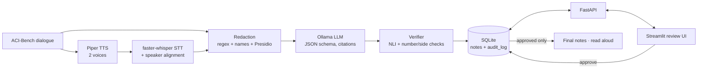

# AI Medical Scribe: Guide Book

A walkthrough of the project: what each part does, why it was built that way, how to run and change it,
and what it cannot do. Read the [README](../README.md) for results and [RUN.md](../RUN.md) for setup.

> **Research demo on synthetic data.** Every consultation comes from ACI-Bench (synthetic, CC BY 4.0).
> This is not a medical device. Never use it with real patient data.

---

## Contents
1. [The idea in one minute](#1-the-idea-in-one-minute)
2. [A tour: one consultation, start to finish](#2-a-tour-one-consultation-start-to-finish)
3. [Architecture](#3-architecture)
4. [The modules, one by one](#4-the-modules-one-by-one)
5. [Safety rules and where they are enforced](#5-safety-rules-and-where-they-are-enforced)
6. [Using the review screen](#6-using-the-review-screen)
7. [The API](#7-the-api)
8. [Testing strategy](#8-testing-strategy)
9. [Evaluation: what the numbers mean](#9-evaluation-what-the-numbers-mean)
10. [Configuration](#10-configuration)
11. [Running on small machines](#11-running-on-small-machines)
12. [Extending the project](#12-extending-the-project)
13. [Troubleshooting](#13-troubleshooting)
14. [Limitations](#14-limitations)
15. [Glossary](#15-glossary)
16. [Talking about this project](#16-talking-about-this-project)

---

## 1. The idea in one minute

A doctor and a patient talk. The scribe turns that conversation into a **SOAP note**:

| Section | Contains | Example |
|---|---|---|
| **S**ubjective | what the patient reports | "Right knee pain for two weeks" |
| **O**bjective | exam findings, vitals, results | "Mild right knee effusion" |
| **A**ssessment | the doctor's diagnosis | "Right knee sprain" |
| **P**lan | tests, treatment, follow-up | "Start ibuprofen 400 mg" |

Language models write fluent notes, but they also **invent things**: a dose nobody said, the wrong knee,
a drug from a different patient. So this project is built around three rules:

1. **Every line cites its evidence**: the numbered transcript segments it came from.
2. **Every line is checked automatically** against those segments and coloured green, amber or red.
3. **Nothing is final until a doctor approves it.** The doctor sees the colours, clicks a line to see its
   evidence, fixes what is wrong and approves. Approved notes are locked and every step is audited.

Everything runs **locally and for free**: Ollama for the LLM, faster-whisper for speech-to-text, Piper for text-to-speech,
Presidio for de-identification, a DeBERTa NLI model for checking, SQLite for storage.

---

## 2. A tour: one consultation, start to finish

Take ACI-Bench case `D2N068`, a follow-up for heart failure. Here is what happens to it.

**1. Load.** `app/loader.py` reads the CSV row. The dialogue looks like
`[doctor] hi , brian . how are you ?` / `[patient] hi , good to see you .`
Each turn becomes a numbered **segment** `{id, start, end, speaker, text}`. Turns over 50 words are split,
so citations stay precise.

**2. (Optional) Audio round trip.** `app/tts.py` speaks the dialogue with two Piper voices (ryan for the doctor,
amy for the patient) into a WAV file. `app/stt.py` transcribes it with faster-whisper and assigns each word to
a speaker. This gives a realistic transcript with real ASR errors, while keeping the data synthetic.

**3. Redact, before anything else.** `app/redact.py` replaces names, phones, emails and IDs:
`hi , brian .` becomes `hi , [NAME] .` From here on, the LLM, the database and the logs only ever see redacted text.

**4. Generate.** `app/generate.py` sends the numbered, redacted segments to Ollama with a strict JSON schema
and these rules: *use only these segments, cite segment IDs for every line, set `unsupported=true` instead of
guessing, keep lines short and atomic.* The reply is validated with Pydantic. If it's invalid, the model gets one retry,
told what was wrong.

```json
{"plan": [{"text": "Increase Lasix to 80 mg daily", "evidence": [41, 42], "unsupported": false}]}
```

**5. Verify.** `app/verify.py` checks each line against *its own cited segments*:
- Do the cited IDs exist?
- Does the cited text **entail** the line? (NLI model, explained in §4)
- Are numbers and left/right/bilateral in the line actually present in the cited text?

Each line gets a status (green, amber or red) and a reason. For non-green lines, it also suggests other segments
that might support it, as a hint for the doctor.

**6. Store a draft.** `app/store.py` saves the note, the redacted segments and the verification in SQLite with
status `draft`, and writes `created` to the audit log.

**7. Review.** In the Streamlit UI (`ui/review.py`) the doctor sees the transcript on the left and the coloured
note on the right. Clicking **Evidence** highlights the cited segments in yellow. The doctor edits, deletes or adds lines;
saving re-redacts and re-verifies only the changed lines. Status becomes `edited`.

**8. Approve.** The doctor enters their name and approves. The note is locked: the database itself refuses
further changes. It now appears in **Final notes**, where it can be downloaded or read aloud.

---

## 3. Architecture



```
             ┌──────────── text path ────────────┐
ACI dialogue ┤                                    ├─▶ redact ─▶ LLM ─▶ verify ─▶ SQLite (draft)
             └─▶ Piper ─▶ WAV ─▶ Whisper ─▶ align ┘                                   │
                                                                                     ▼
           Final notes ◀── approved only ◀── approve ◀── edit (re-redact, re-verify) ◀── review UI
```

| Layer | Files | Talks to |
|---|---|---|
| Data | `app/loader.py`, `data/aci-bench/` | - |
| Speech | `app/tts.py`, `app/stt.py`, `app/textnorm.py` | Piper, faster-whisper |
| Privacy | `app/redact.py`, `app/data/common_word_names.txt` | Presidio, spaCy |
| Generation | `app/generate.py`, `app/schema.py` | Ollama `/api/chat` |
| Checking | `app/verify.py`, `app/evidence.py` | DeBERTa NLI (or an Ollama judge) |
| Orchestration | `app/pipeline.py` | all of the above |
| Storage | `app/store.py` | SQLite |
| Service | `app/main.py` | FastAPI |
| UI | `ui/review.py` | the API over HTTP |
| Launcher | `run.py` | starts API + UI |
| Evaluation | `eval/*.py` | everything, offline |

---

## 4. The modules, one by one

### `schema.py`: the contract
`NoteItem {text, evidence: list[int], unsupported: bool}` and `SOAPNote {subjective, objective, assessment, plan}`.
Validators strip blank lines, deduplicate evidence and cap the number of cited IDs. `soap_json_schema()` produces the schema
handed to Ollama's `format` parameter, so the model is *constrained* to produce this shape.

### `loader.py`: data
Reads the ACI-Bench CSVs, turns dialogues into segments and maps each free-text reference note onto SOAP sections
(e.g. "HISTORY OF PRESENT ILLNESS" → S, "PHYSICAL EXAM" → O). ACI-Bench's combined "ASSESSMENT AND PLAN" blocks are split:
bullets such as `Medical Treatment:` or `Follow-up:` go to P, and the rest to A.

### `generate.py`: the LLM call
- `OllamaClient.chat()` posts to `/api/chat` with temperature 0.1, a fixed seed, `num_ctx` 8192 and a cap on output tokens
  (`num_predict`, which stops small models from looping forever inside a JSON array).
- `generate_note()` validates the output, removes duplicate lines, and on failure retries **once** with the validation error.
  After that it raises `GenerationError` (the API turns this into HTTP 502).
- Tests use a scripted fake client, so no Ollama is needed.

### `verify.py` + `evidence.py`: the checker
**NLI (natural-language inference)** asks: *does text A (premise) entail text B (hypothesis)?* The cross-encoder
`cross-encoder/nli-deberta-v3-base` returns probabilities for entailment, neutral and contradiction.

For each line:
1. Premise = the cited segments with speaker labels. If a cited turn is very short ("yes ."), the previous turn is added
   as context, because "yes" means nothing without the question.
2. The model scores both the raw line and a section-framed version ("The doctor's plan: start ibuprofen")
   and keeps the better one. NLI models read bare fragments as neutral.
3. Rules turn the scores into a status:

| Status | Triggered by |
|---|---|
| 🟥 red / unsupported | no evidence · non-existent IDs · `unsupported=true` · contradiction ≥ 0.5 · entailment < 0.2 |
| 🟧 amber / flagged | entailment 0.2–0.5 · a number or left/right/bilateral missing from the cited text · some invalid IDs · more than 6 IDs |
| 🟩 green / supported | everything else |

The **number and laterality check** exists because NLI models are weakest exactly where errors are most dangerous:
"Lasix 40 mg" vs "Lasix 80 mg", or left vs right knee.

**Suggestions** come from a small TF-IDF index over the segments. They are shown as "hint: maybe see segments 5, 4, 6" and
never change a status: the doctor decides.

`reverify_note()` re-checks only lines whose text, evidence or flag changed, so saving an edit takes under a second.

### `redact.py`: de-identification
Three layers, in order:
1. **Regex rules**: phones, emails, MRN/ID numbers, dates of birth (as `[ID]`).
2. **Name lists and context rules**: a Faker first/last-name list, plus cues such as "hi, X", "Mr./Dr. X", "my name is X",
   relations ("my wife X") and dictation phrases.
3. **Presidio + spaCy** `en_core_web_sm` for whatever is left.

Names that are also everyday words (Mark, Bill, Lot, Job; 494 words from the SCOWL dictionary) are only redacted when
name context is present. Without that rule, "a lot" became "a [NAME]".
`install_log_redaction()` installs a global log-record factory, so **every log line from every library** passes through
redaction too.

### `tts.py` / `stt.py` / `textnorm.py`: speech
- Piper turns ACI's tokenised lowercase text into speech. `speakable()` restores sentence case and punctuation, because espeak only
  starts a new sentence at a capital letter, and lowercase run-ons made Piper drop words (it once dropped a whole
  metformin dose). It also maps "mm-hmm" → "uh-huh" (Whisper hears "mm-hmm" as "I don't know") and reads placeholders aloud.
- faster-whisper `base.en` (int8, CPU) transcribes with word timestamps. Each word is assigned to the synthesised turn
  it overlaps most, which gives an exact speaker label without needing diarization. For uploaded audio with no reference turns,
  speakers are `unknown`, unless pyannote is switched on (`SCRIBE_DIARIZE=1` plus a Hugging Face token).
- Bad audio raises `AudioValidationError` with a clear message (not found, empty, undecodable, too short, silent), shown to the user as HTTP 422.

### `store.py`: SQLite and the audit log
Two tables: `notes(id, status, json, created_at, …)` and `audit_log(seq, note_id, action, before, after, ts)`.
**Triggers** in the database make approved notes immutable and the audit log append-only, so the rules hold even
if someone bypasses the API with a SQL client. Every edit stores the full before/after JSON. Approval records who approved and
the red/amber/green counts at that moment.

### `main.py`: the API
FastAPI app built by `create_app(services)`. `Services` holds the store, the LLM client, the verifier and the voices; tests inject
fakes, production builds the real ones lazily. Errors map to clear codes: 404 unknown note, 409 locked/not approved,
413 upload too big, 422 bad input, 502 invalid LLM output, 503 Ollama down.

### `ui/review.py`: the review screen
A Streamlit app that only talks to the API over HTTP, so the UI holds no data and can't skip the approval gate.
Details are in §6.

### `run.py`: the launcher
Checks Python packages, Ollama and the model, and that the ports are free. It starts the API, waits for `/health`, then starts the UI.
If the API dies, it prints the API's own error. `--demo` swaps in scripted models.

---

## 5. Safety rules and where they are enforced

| Rule | Enforced in | Proven by |
|---|---|---|
| Synthetic data only | loader reads ACI-Bench only; README and UI banner | - |
| Redact before storing or logging | `pipeline.prepare_*` runs redaction first; `PUT /note` re-redacts edits; global log factory | `test_redact.py`, `test_api.py::test_doctor_edits_are_redacted_before_storage`, `test_pipeline.py` |
| Never invent facts silently | prompt rules + `unsupported` flag + verifier colours + "no evidence" = red | `test_verify.py`, NLI gold set (`test_verify_nli.py`) |
| Nothing final until approved | `/final` and `/audio` return 409 for drafts; UI final view lists approved notes only | `test_store.py::test_approval_gate`, `test_api.py::test_approval_gate_end_to_end`, E2E `test_final_view_only_lists_approved_notes` |
| Approved notes can't change | API 409 + SQLite triggers | `test_store.py::test_database_triggers_protect_approved_notes_and_audit` |
| Every step is audited | store writes created/edited/approved/read_aloud with before/after | `test_store.py`, E2E audit check |

---

## 6. Using the review screen

1. **Start:** `python run.py` (or `python run.py --demo`). Open http://localhost:8501.
2. **New draft** (sidebar): choose
   - **ACI case**: pick an encounter, and either *text* or *audio* (Piper → Whisper round trip),
   - **Paste**: any `[doctor] … / [patient] …` dialogue,
   - **Upload audio**: WAV/MP3/FLAC; speakers will be `unknown`.
3. **Read the colours:** each line shows a dot, its cited IDs and, if not green, the reason.
4. **Evidence:** highlights the cited segments (yellow) and any context turn (light yellow), and shows the quotes under the line.
   Red lines with no support say so.
5. **Edit note** (toggle): change text, change evidence IDs (comma-separated), tick *unsupported*, tick *delete*, or fill the
   empty row to add a line. **Save edits** re-redacts and re-verifies the changed lines.
6. **Approve:** type your name and click **Approve note**. You'll get a warning if red lines remain; approval is still allowed
   (red is a warning, not a blocker), and the counts are recorded in the audit log.
7. **After approval:** read-only. **Read approved note aloud** plays Piper audio. The **Final notes** view lists approved notes with
   a Markdown download. **Audit history** shows every step.

---

## 7. The API

| Method | Path | Purpose |
|---|---|---|
| POST | `/process` | JSON `{encounter_id, input: "text"\|"audio", max_turns}` or `{dialogue}`, or multipart `audio`. Returns the draft (201) |
| GET | `/note/{id}` | note + redacted segments + verification + status |
| PUT | `/note/{id}` | `{note, actor}`: save edits (409 if approved) |
| POST | `/note/{id}/approve` | `{actor}`: lock the note |
| GET | `/note/{id}/audit` | audit entries |
| GET | `/notes?status=` | list notes |
| GET | `/final`, `/final/{id}` | approved notes only |
| GET | `/note/{id}/audio` | WAV of an approved note |
| GET | `/cases`, `/health` | ACI case list; liveness incl. Ollama |

Interactive docs: http://localhost:8000/docs while the API runs.

```bash
curl -X POST localhost:8000/process -H 'content-type: application/json' \
     -d '{"encounter_id": "D2N068", "input": "text"}'
curl -X POST localhost:8000/note/1/approve -H 'content-type: application/json' -d '{"actor": "dr_demo"}'
curl localhost:8000/final/1
```

---

## 8. Testing strategy

| Layer | What | Where | Command |
|---|---|---|---|
| Unit | schema validation, redaction (seeded fake PII), verifier rules, empty/bad audio errors, store gate, eval metrics | `tests/test_*.py` | `make test` |
| Integration | audio upload → STT → segments through FastAPI; ACI case as audio | `tests/test_api.py` (slow-marked) | `make test-slow` |
| API | every endpoint and error code with `TestClient` and fakes | `tests/test_api.py` | `make test` |
| Model-backed | real NLI on a 40-line gold set; real Piper voices; Piper→Whisper WER < 15% | `tests/test_verify_nli.py`, `test_tts.py`, `test_stt.py` | `make test-slow` |
| E2E | Playwright drives the real Streamlit UI against the real API with scripted models | `tests/e2e/` | `make e2e` |
| AI eval | WER (jiwer), redaction recall, verifier catch rate, note quality (ROUGE-L, BERTScore, invented/missing facts) | `eval/` | `make eval` etc. |

**Why fakes?** LLM output varies between runs, and tests must be fast and deterministic. `FakeLLM` returns scripted JSON,
`FakeEntailer` returns scripted scores, and `FakeVoice` writes silence. The real models are tested separately (slow tests, smoke
scripts, evaluation).

---

## 9. Evaluation: what the numbers mean

`eval/run_eval.py` runs in three steps, each in its own process so the models never share RAM:
1. **prepare**: redact the transcripts *and* the reference notes, so `[NAME]` in one matches `[NAME]` in the other.
2. **generate**: one note per case per model, cached in `eval/results/notes/` (re-runs skip finished cases).
3. **score**: per SOAP section:
   - **ROUGE-L**: overlap of the longest common word sequences with the reference note (0–1). Rewards similar
     *wording*, so it is low even for good notes that are phrased differently.
   - **BERTScore** (rescaled): similarity of contextual embeddings. More tolerant of paraphrase. Rescaled scores can be
     below 0. The default `distilbert-base-uncased` fits small machines; `--bertscore-model roberta-large` is the standard choice.
   - **Invented facts**: a generated line is invented if **no** transcript passage entails it. The check covers the cited segments
     plus the 4 most similar transcript windows. This differs from the verifier's red, which also fires when the fact is true but
     the citation is wrong.
   - **Missing facts**: a reference-note sentence is missing if the generated note doesn't entail it.
   - **Verifier colours**: the share of red, amber and green lines.

Outputs: `eval_cases.csv` (one row per case per model), `eval_facts.csv` (every line and reference sentence with its score,
for auditing), `eval_summary.csv` and `eval_summary.md`.

**Read the fact counts as estimates.** NLI can be fooled by word overlap: in a pilot run, "the patient has swollen legs" counted as
supported because the doctor *asked* about swollen legs. In the final run, "Denies shortness of breath" counted as covered by a
note saying the patient *has* shortness of breath. It can also accept a long reference sentence when the note covers only part of it.
`eval_facts.csv` lets you check any judgement by hand.

Run it yourself:
```bash
python eval/run_eval.py --models qwen2.5:7b --n 20              # all stages
python eval/run_eval.py --models qwen2.5:7b --stage score       # re-score cached notes
```

---

## 10. Configuration

All settings are environment variables (see `app/config.py`):

| Variable | Default | Meaning |
|---|---|---|
| `SCRIBE_MODEL` | `qwen2.5:7b` | Ollama model |
| `SCRIBE_OLLAMA_HOST` | `http://localhost:11434` | Ollama URL |
| `SCRIBE_TEMPERATURE` / `SCRIBE_SEED` | `0.1` / `0` | sampling |
| `SCRIBE_NUM_CTX` / `SCRIBE_NUM_PREDICT` | `8192` / `3072` | context window / output cap |
| `SCRIBE_REPEAT_PENALTY` / `SCRIBE_REPEAT_LAST_N` | `1.1` / `64` | use `1.15` / `256` for 0.5b–1.5b models |
| `SCRIBE_KEEP_ALIVE` | `5m` | how long Ollama keeps the model loaded |
| `SCRIBE_NUM_BATCH` | unset | smaller Ollama prompt batches (e.g. `128`) use less RAM |
| `SCRIBE_VERIFIER` | `nli` | `nli` or `ollama` (LLM judge) |
| `SCRIBE_NLI_MODEL` | `cross-encoder/nli-deberta-v3-base` | `…-xsmall` for low RAM |
| `SCRIBE_ENTAIL_THRESHOLD` / `SCRIBE_WEAK_THRESHOLD` / `SCRIBE_CONTRADICTION_THRESHOLD` | `0.5` / `0.2` / `0.5` | colour rules |
| `SCRIBE_MAX_EVIDENCE_OK` | `6` | more cited IDs than this → amber |
| `SCRIBE_WHISPER_MODEL` / `SCRIBE_WHISPER_COMPUTE` | `base.en` / `int8` | STT |
| `SCRIBE_DOCTOR_VOICE` / `SCRIBE_PATIENT_VOICE` | `en_US-ryan-medium` / `en_US-amy-medium` | Piper voices |
| `SCRIBE_DIARIZE` + `HF_TOKEN` | `0` | pyannote diarization for uploads |
| `SCRIBE_DB` | `data/scribe.db` | SQLite file |
| `SCRIBE_API_URL` | `http://localhost:8000` | where the UI finds the API |
| `SCRIBE_MAX_UPLOAD_MB` | `50` | upload limit |
| `SCRIBE_LOW_MEMORY` | `0` | free Whisper/Piper/NLI before each LLM call |

---

## 11. Running on small machines

The whole project was built and tested in a 2 GB RAM, 2-CPU sandbox with no GPU. What helped:
- **Small models:** `qwen2.5:1.5b` or `0.5b` with `SCRIBE_REPEAT_PENALTY=1.15 SCRIBE_REPEAT_LAST_N=256` (tiny models loop without them).
- **`SCRIBE_LOW_MEMORY=1` + `SCRIBE_KEEP_ALIVE=0`:** only one big model in RAM at a time.
- **`SCRIBE_NLI_MODEL=cross-encoder/nli-deberta-v3-xsmall`:** caught 83% of hallucinations on the gold set, vs 89% for base.
- **Ollama server:** `OLLAMA_FLASH_ATTENTION=1 OLLAMA_KV_CACHE_TYPE=q8_0` halves the context memory; `SCRIBE_NUM_BATCH=128`
  shrinks the prompt buffers. Together these let 1.5b run in 2 GB, with occasional out-of-memory crashes that the evaluation retries.
- Run the evaluation in stages; it already uses separate processes.

With 16 GB RAM none of this is needed: use the defaults (`qwen2.5:7b`, NLI base).

---

## 12. Extending the project

- **Another LLM:** `ollama pull llama3.1:8b` and set `SCRIBE_MODEL=llama3.1:8b`. Any model that supports JSON-schema `format` works.
  Then compare: `python eval/run_eval.py --models qwen2.5:7b,llama3.1:8b`.
- **Another verifier:** implement `judge(pairs) -> list[Judgement]` (see the `Entailer` protocol in `verify.py`) and return it from
  `get_entailer()`.
- **Another note format:** change `SECTIONS` and `SOAPNote` in `schema.py`, the header mapping in `loader.py` and the section frames in
  `verify.py`.
- **More PII types:** add a regex rule or Presidio recognizer in `redact.py`, plus seeded fake examples in `tests/test_redact.py`
  and `eval/redaction_eval.py`.
- **Real diarization:** `SCRIBE_DIARIZE=1` and `HF_TOKEN=…` after accepting the pyannote licence on Hugging Face.

---

## 13. Troubleshooting

| Symptom | Cause | Fix |
|---|---|---|
| "API not reachable" in the UI | API not running | `python run.py` starts both and shows the API's real error |
| HTTP 503 "Ollama is not reachable" | Ollama not running | start the Ollama app or `ollama serve` |
| HTTP 502 "model output invalid" | model produced bad JSON twice | larger model; for tiny models set the repeat-penalty variables |
| `llama-server … signal: killed` | out of memory | smaller model, `SCRIBE_LOW_MEMORY=1`, Ollama memory settings (§11) |
| Everything red | small model cites wrong segments | expected for 0.5b; use 7b; the hints show where the support is |
| HTTP 422 on upload | empty, silent, too short or undecodable audio | the message says which |
| Read-aloud fails | Piper voices missing | `python scripts/download_voices.py` |
| First request very slow | Whisper and NLI models downloading | wait once; they are cached afterwards |

---

## 14. Limitations

- **Synthetic data only.** ACI-Bench conversations are clean and scripted. Real clinics have noise, overlapping speech, accents and
  interruptions. The synthetic audio (Piper voices) is far easier than real recordings, so the WER is a lower bound.
- **Small models in our evaluation.** The numbers in the README come from 0.5b and 1.5b models (the 2 GB sandbox couldn't run 7b).
  They show how the pipeline behaves: valid JSON every time, but ~28% invented lines and notes far too short (~88% of reference
  facts missing). They don't measure what a 7b+ model can do.
- **The verifier checks against the transcript, not the truth.** If Whisper mishears "lisinopril" as "listen apple", the verifier
  can't know. Clinically similar substitutions ("erythema" for "effusion") also pass NLI.
- **Automatic fact counts are estimates** (see §9). No clinician reviewed the outputs.
- **Redaction is good but not perfect:** 95–100% on seeded PII. Particle surnames ("de la O") and some three-word names
  leak, and a capitalised drug name ("Cisplatin" in a reference note) was once redacted as `[NAME]`. Never use real data.
- **Approval is not authentication.** The reviewer name is typed, not logged in. A real system needs user accounts, roles,
  signatures and access logs.
- **Not a medical device** and not validated for any clinical use.

---

## 15. Glossary

| Term | Meaning |
|---|---|
| SOAP | Subjective, Objective, Assessment, Plan: the standard clinical note layout |
| ACI-Bench | Ambient Clinical Intelligence benchmark: synthetic doctor–patient dialogues with reference notes (Yim et al., 2023) |
| Segment | one numbered transcript turn (or part of a long turn) that note lines cite |
| Evidence | the segment IDs a note line cites |
| NLI | natural-language inference: does a premise entail, contradict or say nothing about a hypothesis? |
| Hallucination / invented fact | a statement not supported by the source |
| WER | word error rate of speech-to-text: (substitutions + deletions + insertions) / reference words |
| ROUGE-L | overlap metric based on the longest common subsequence of words |
| BERTScore | similarity metric based on contextual word embeddings |
| PII / PHI | personally identifiable / protected health information |
| Diarization | working out who spoke when |

---

## 16. Talking about this project

**Resume bullet**
> Built a local, open-source AI medical scribe (Python, FastAPI, Streamlit, SQLite, Ollama, faster-whisper, Piper,
> Presidio). It turns doctor–patient audio into evidence-linked SOAP notes, flags unsupported statements with an NLI verifier
> (89% hallucination catch rate, 0% false alarms on a labelled set), redacts PII before storage (99.6% name recall),
> and enforces doctor approval with an immutable audit log. Covered by 230+ tests, from unit tests to Playwright E2E.

**Short pitch (30 seconds):** "LLMs write fluent clinical notes but invent details. My scribe makes every note line cite the
transcript segments it came from, checks each line automatically with an NLI model and colours it green, amber or red. A doctor
then reviews, edits and approves before anything is final. It runs fully locally on free models, with redaction before anything
is stored."

**Questions you may get:**
- *Why NLI instead of asking the LLM whether it is right?* Measured: a small LLM judge caught 33% of planted hallucinations,
  NLI base caught 89% with no false alarms. A separate, smaller, deterministic model is also easier to test.
- *Why let doctors approve notes with red lines?* Red means "no support found", not "false". Doctors can know things that
  weren't said. Blocking them would push them to delete true facts. Instead, approval records how many lines were red.
- *What was hardest?* Speech details. Lowercase text made Piper drop words, "mm-hmm" became "I don't know", and a regex for "mm"
  turned "5 mm lesion" into "5 uh-huh lesion". Each became a regression test.
- *What would you do next?* Evaluate with a 7b+ model and clinician review, test on real noisy audio (with consent and
  approval), add user accounts and signatures, and check drug names against a formulary to catch ASR errors.

---

**Data and licences:** ACI-Bench © its authors, CC BY 4.0. Cite: Yim, W. et al. *ACI-BENCH: a Novel Ambient Clinical
Intelligence Dataset for Benchmarking Automatic Visit Note Generation.* Scientific Data 10, 586 (2023).
Piper voices, faster-whisper, Presidio, DeBERTa NLI cross-encoders and Qwen2.5 are used under their own open licences.
The SCOWL word list (used for everyday-word names) is © Kevin Atkinson.
